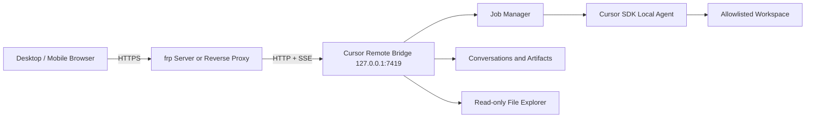

# Cursor Remote Bridge

### Cursor 远程桥接

通过浏览器远程驱动本机 Cursor，在锁屏状态下继续执行代码任务，并流式查看输出、文件和代码改动。

Cursor Remote Bridge 是一个运行在 Windows 本机的轻量桥接服务。它使用 Cursor 官方 SDK 启动本地 Agent，将任务执行、对话上下文、模型选择、文件浏览和代码变更检查集中到一个可在桌面端与移动端使用的 Web 控制页中。

Drive a local Cursor coding agent from any browser, keep tasks running while the PC is locked, and inspect streamed output, source files, and code changes.

> [!IMPORTANT]
> 这是自托管工具。获得 Bridge Token 的浏览器可以调用当前 Windows 用户权限下的 Cursor Agent。请使用强 Token，并限制公网访问范围。

## 功能

- **浏览器控制本机 Cursor** 不依赖 Cursor 桌面聊天窗口，通过 Web 页面提交任务并实时接收 SSE 事件。
- **锁屏继续执行** Windows 用户保持登录会话时，锁屏不会终止 Node、Cursor SDK Agent 或本地工具调用。
- **完整对话体验** 问题、回答、思考、工具调用和状态持久化保存，会话按 Workspace 分组，并可在刷新页面后恢复。
- **上下文续接** 同一会话通过 Cursor `agentId` 调用 `Agent.resume`，后续任务可以继续使用前文上下文。
- **模型切换** 动态读取当前 Cursor 账号可用的模型，支持切换模型以及 Fast、Speed、Turbo、Strength 等模型参数。
- **可控任务执行** 支持排队、并发限制、超时、停止和运行中指令插入。中断请求优先交给 Cursor `run.steer()` 处理。
- **结构化流式输出** 思考、状态和工具调用默认折叠，最终回答单独渲染。Markdown 支持标题、列表、表格、引用和代码块。
- **Workspace 管理** 可以直接读取本机目录、手动填写路径、添加或删除白名单工作区。删除工作区时会清理其 Bridge 会话记录。
- **只读 Explorer** 页面内展开项目文件树，以带行号的代码视图预览文本和关键源文件，Markdown 支持格式化与源码切换。
- **代码改动检查** 任务结束后刷新文件和 Git 状态标记，生成 `changes.diff` 与 `git-status.txt`，包含新增文件内容。
- **远程访问模式** 首次从远程地址访问时输入 Bridge Token，Token 只保留在当前页面的内存中。
- **双主题与移动端** 支持白色与暗色主题。移动端左侧菜单默认收起，文件树使用右侧抽屉，长按 Workspace 可以删除。

## 工作方式



Bridge 默认只监听 `127.0.0.1`。本地使用时，浏览器直接访问 `http://127.0.0.1:7419`。需要从其他设备访问时，通过 frp、Caddy、Nginx 或其他反向代理提供 HTTPS 入口。

Cursor Agent 在当前 Windows 用户会话中运行，文件修改、终端命令和 Git 操作都在所选 Workspace 内进行。

## 快速开始

### 环境要求

- Windows 10 或 Windows 11
- Node.js 22.13 或更高版本
- Git
- 已登录 Cursor 的账号
- Cursor SDK 可用的 API Key

### 1. 安装

```powershell
git clone https://github.com/ziwen-dev/cursor_remote_control.git D:\projects\cursor-remote-bridge
cd D:\projects\cursor-remote-bridge
npm ci
```

### 2. 配置允许访问的工作区

从示例生成本机配置。

```powershell
Copy-Item .\config\bridge.config.example.json .\config\bridge.config.json
```

编辑 `config\bridge.config.json`，至少保留一个本机存在的绝对路径。该文件是本机配置，已经由 `.gitignore` 排除。

```json
{
  "host": "127.0.0.1",
  "port": 7419,
  "allowedWorkspaces": [
    "D:\\projects\\example"
  ],
  "runner": {
    "mode": "cursor-sdk",
    "model": "composer-2",
    "allowStoredAuth": true
  }
}
```

`allowedWorkspaces` 中的目录及其子目录允许作为 Cursor 任务工作区，其他路径会被拒绝。

### 3. 配置 Cursor API Key

推荐使用 Cursor SDK 交互登录。

```powershell
cd D:\projects\cursor-remote-bridge
npm run cursor-login
```

也可以从 Cursor Dashboard 创建 API Key，再使用安全输入脚本保存到本机。

```powershell
powershell.exe -NoProfile -ExecutionPolicy Bypass -File scripts\set-cursor-key.ps1
```

完整的登录、Dashboard 获取 Key、凭据优先级、模型验证和过期处理方法见 [Cursor API Key 获取与配置](docs/cursor-api-key.md)。

### 4. 启动

首次启动建议在前台运行，便于观察配置错误。

```powershell
cd D:\projects\cursor-remote-bridge
npm start
```

浏览器打开 [http://127.0.0.1:7419](http://127.0.0.1:7419)。本地访问会自动读取 Bridge Token，选择 Workspace 后即可发送任务。

检查服务状态。

```powershell
Invoke-RestMethod http://127.0.0.1:7419/health
```

### 5. 配置开机自启动

```powershell
cd D:\projects\cursor-remote-bridge
npm run autostart:install
```

安装器会登记并立即启动 Windows 计划任务 `CursorRemoteBridge`。以后每次登录 Windows 时，任务通过 `wscript.exe` 在后台启动 Node，登录时不会弹出控制台或浏览器。任务状态可在「任务计划程序」中查看。需要手动打开控制页时，可以双击项目根目录的 [`start-bridge.cmd`](start-bridge.cmd)。

## 使用说明

### Workspace 与会话

左侧按 Workspace 分组显示对话。点击 Workspace 旁的添加按钮，可以填写本机绝对路径或使用目录选择。当前工作区的对话默认展开，其他工作区默认收起。

同一会话的任务串行执行，模型会通过 `agentId` 继续上一轮上下文。点击“新对话”会创建空白会话。切换 Workspace 不会把旧会话的上下文混入新项目。

### 输出与代码检查

每轮的思考内容合并在默认收起的 `thinking` 中。思考进行时标签会有扫光动效，点击可查看连续文本。展开后，手动向上滚动可以暂停跟随。工具调用和状态位于单独的活动记录中，最终回答以 Markdown 形式显示。

顶部文件按钮打开只读 Explorer。目录按需加载，源码显示行号，Markdown 支持格式化视图。任务结束后，Explorer 会刷新已展开目录和当前文件。

每次任务的主要产物保存在 `data/jobs/<job-id>/`。

| 文件 | 内容 |
| --- | --- |
| `final.md` | Cursor Agent 的最终回答 |
| `events.ndjson` | 流式事件与运行状态 |
| `changes.diff` | Git 工作区改动与新增文本文件 |
| `git-status.txt` | 任务结束时的 Git 状态 |

### 模型与参数

控制页通过 Cursor SDK 读取当前账号的模型目录。模型列表包含 `parameters` 和 `variants` 时，页面会显示对应下拉框或开关。Fast、Speed 和 Turbo 类参数使用开关，强度等其他参数使用下拉框。

也可以直接调用模型接口。

```powershell
$token = (Get-Content .\data\api-token.txt -Raw).Trim()
$headers = @{ Authorization = "Bearer $token" }
$models = (Invoke-RestMethod `
  -Uri http://127.0.0.1:7419/v1/models `
  -Headers $headers).models
$models | Select-Object id, displayName, description
```

### 停止与中断

- “停止”调用 Bridge 取消接口，并终止当前 Cursor Run。
- “中断”把新的指令交给当前 Run。Cursor 接受时使用 `run.steer()` 调整执行方向，无法即时接入时则作为后续任务排队。

## API

除 `/health` 外，所有 `/v1/*` 接口都要求 Bearer Token。

| 方法 | 路径 | 用途 |
| --- | --- | --- |
| `GET` | `/health` | 服务健康检查 |
| `GET` | `/v1/meta` | 服务、工作区和并发配置 |
| `GET` | `/v1/models` | 当前账号的 Cursor 模型和参数 |
| `GET` | `/v1/conversations` | 按对话聚合的历史记录 |
| `GET` | `/v1/jobs` | 最近任务 |
| `POST` | `/v1/jobs` | 创建任务 |
| `GET` | `/v1/jobs/:id/events` | SSE 流式事件 |
| `POST` | `/v1/jobs/:id/cancel` | 停止任务 |
| `POST` | `/v1/jobs/:id/interrupt` | 插入运行中指令 |
| `GET` | `/v1/files` | 浏览 Workspace 文件树 |
| `GET` | `/v1/file` | 读取文本文件预览 |

创建任务示例。

```powershell
$token = (Get-Content .\data\api-token.txt -Raw).Trim()
$headers = @{ Authorization = "Bearer $token" }
$body = @{
  workspace = "D:\projects\example"
  prompt = "检查当前项目，修复构建错误并运行相关测试。"
  model = "composer-2"
  timeoutSeconds = 1800
  idempotencyKey = [guid]::NewGuid().ToString()
} | ConvertTo-Json

$job = (Invoke-RestMethod -Method Post `
  -Uri http://127.0.0.1:7419/v1/jobs `
  -Headers $headers `
  -ContentType application/json `
  -Body $body).job
$job.id
```

## 远程访问

### 使用 frp

frp 为可选依赖。运行 Windows 本地隧道验证脚本时，将官方 Windows amd64 压缩包中的 `frpc.exe` 放入 `bin/`，将 `frps.exe` 放入 `vendor/frp_0.72.0_windows_amd64/`。仓库提供配置模板和校验和。[frp v0.72.0 官方发行包](https://github.com/fatedier/frp/releases/tag/v0.72.0) · [校验和](frp_sha256_checksums.txt)

[`frp/`](frp/) 中提供了服务端、客户端和 Caddy 配置示例，本地 `frpc -> frps -> HTTP vhost -> bridge` 链路已完成冒烟测试。

公网部署还需要准备真实的云服务器、域名或公网 IP、frps 服务、TLS 证书和身份验证策略。当前项目尚未完成真实云服务器的端到端验证。

公网入口建议使用 HTTPS。使用 `http://服务器IP:端口` 可以完成内网或临时链路测试，但任务指令和 Bridge Token 都会经过该入口，长期暴露到互联网时应使用 TLS。

可以暴露 frp 控制端口和 Web 入口，不要直接把本机 `7419` 映射到公网。参考配置文件：

- [`frp/frps.toml.example`](frp/frps.toml.example)
- [`frp/frpc.toml.example`](frp/frpc.toml.example)
- [`frp/Caddyfile.example`](frp/Caddyfile.example)

远程打开控制页后，页面会要求输入 Bridge Token。Token 只保存在当前页面的 JavaScript 内存中，刷新或关闭页面后需要重新输入。

### Bridge Token 与 Cursor API Key

| 凭据 | 用途 | 保存位置 | 页面输入 |
| --- | --- | --- | --- |
| Bridge Token | 保护 Bridge 的 `/v1/*` API 和远程控制页 | `data/api-token.txt` | 远程首次访问时输入 |
| Cursor API Key | 允许本机 Cursor SDK 调用 Agent 和模型服务 | Cursor SDK 凭据文件或 `data/cursor-api-key.txt` | 不需要 |

不要把 Cursor API Key 当作 Bridge Token。两个凭据的权限和用途不同。

## 配置说明

主配置文件为 `config/bridge.config.json`，仓库中的公开模板为 [`config/bridge.config.example.json`](config/bridge.config.example.json)。

| 字段 | 作用 |
| --- | --- |
| `host` | 服务监听地址，默认 `127.0.0.1` |
| `port` | 服务端口，默认 `7419` |
| `allowedWorkspaces` | 允许 Cursor 执行任务的本机目录 |
| `maxConcurrentJobs` | 同时运行的 Cursor Agent 数量 |
| `maxQueuedJobs` | 等待队列上限 |
| `defaultTimeoutSeconds` | 默认任务超时 |
| `runner.mode` | 运行器模式，Cursor SDK 使用 `cursor-sdk` |
| `runner.model` | 默认 Cursor 模型 |
| `runner.settingSources` | 自动加载 Cursor 规则的来源，例如 `["project"]` |
| `runner.autoReview` | 是否自动审核无人值守的工具调用 |

## 安全边界

- 服务默认只监听回环地址 `127.0.0.1`。
- `/v1/*` 使用 Bearer Token 鉴权，并采用常量时间比较。
- Workspace 同时校验原始路径和 `realpath`，符号链接不能绕过白名单。
- 文件预览为只读接口，拒绝绝对路径、`..` 越界、不可读文件和敏感文件。
- `.env`、私钥、Bridge Token、Cursor SDK 凭据和可执行文件不会通过文件接口返回。
- 文本预览限制为 1.5 MB，二进制或可执行对象不会被下载执行。
- `.git`、`node_modules`、`.agent-runs` 等目录不显示在 Explorer 中。
- `data/` 已由 [`.gitignore`](.gitignore) 排除，不应提交任何 Token 或任务记录。

Cursor Agent 使用当前 Windows 用户权限执行工具和 shell。Bridge Token 应当按高权限凭据保管，并定期轮换。

## 锁屏与开机启动

Windows 锁屏会保留当前用户登录会话，因此计划任务、Node 服务和 Cursor 子进程可以继续工作。锁屏可用不等于绕过 Windows 安全策略，注销用户或未登录 Windows 时服务不会按该会话启动。

如需在接电源时保持服务持续运行，可以配置系统不睡眠。

```powershell
powershell.exe -NoProfile -ExecutionPolicy Bypass -File scripts\configure-lock-support.ps1 -Apply
```

该脚本只调整接通电源时的睡眠和休眠策略，显示器仍可关闭。

## 当前限制

- 当前主要面向 Windows 和本机 Cursor SDK Agent。
- 锁屏执行要求用户仍处于登录会话，重启后需要该用户登录 Windows。
- 文件 Explorer 目前只读，不支持在网页内编辑文件。
- 真实云服务器上的 frp 与 HTTPS 端到端链路尚未完成验证。
- Cursor 模型、参数和可用额度取决于当前账号与团队策略。

## 开发与验证

```powershell
npm run check
npm test
```

自动化测试覆盖鉴权、任务调度、SSE、幂等、Workspace 白名单、超时、取消、SDK Runner、对话续接、持久化、响应式页面资源和只读文件浏览。

真实 Cursor SDK 只读回归可以运行：

```powershell
node scripts\verify-cursor-real.mjs
```

脚本默认验证 Bridge 项目自身。验证其他已加入白名单的项目时，设置 `VERIFY_WORKSPACE`。

```powershell
$env:VERIFY_WORKSPACE = "D:\projects\example"
node scripts\verify-cursor-real.mjs
```

## 文档

- [Cursor API Key 获取与配置](docs/cursor-api-key.md)
- [Cursor 官方 SDK 功能梳理](docs/cursor-official-sdk-capabilities.md)
- [项目名称与 GitHub 发布文案](PROJECT_NAME.md)
- [frp 配置示例](frp/)
- [Windows 自启动脚本](scripts/install.ps1)

## 项目名称

英文名称 **Cursor Remote Bridge**，中文名称 **Cursor 远程桥接**。GitHub 仓库名为 `cursor_remote_control`。
